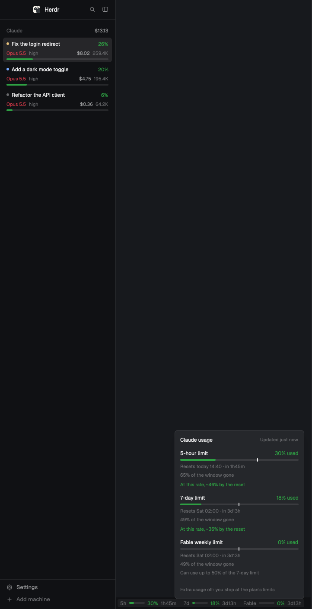

# Claude usage

Claude Code's usage in Herdr. A sidebar list shows a row per Claude Code agent with its
status, model, effort, cost and how full its context is, plus what they've cost together.
A strip in the bottom bar shows the account's 5-hour and 7-day limits and the per-model
weekly ones, with the time left until each resets. Clicking the strip opens a panel with
each limit's reset time and where it's heading. Notifications warn you when a limit is
running out or an agent's context is nearly full. Right-clicking an agent shows
everything known about it and lets you switch its effort or model, or compact it. All of
it comes from what Claude Code hands its status line command.

## What you see

One mod, `claude-usage`, with two views chosen by `props.view`.

**Agents** (`"agents"`, the default; meant for the sidebar, e.g. under `sidebar-lists`,
`{ "weight": 1 }`, `min` 90). Background `chrome`, 1px top border in `border`, text 12px.
- Header: 41px tall (14px top padding, 5px bottom, 16px sides), "Claude", 11.5px medium,
  `dim`. On the right is the sum of the listed agents' costs (11.5px `muted`, tooltip
  "What the agents listed have cost so far"), shown when it's above $0. With no agents:
  "No Claude Code agents", 12px `dim`.
- A scrolling list, 8px side padding, 2px gap: blocked agents first, then the rest in
  Herdr's order. Each row has 8×5px padding, 6px radius, `selected` background when the
  agent is focused and `hover` on hover. A row has:
  - line 1: a 6px round dot in the theme's color for the agent's status (`working`,
    `blocked`, `done`, `idle`; `unknown` otherwise), the label (`foreground`, truncated),
    then the context percent on the right (11.5px medium, in the level color);
  - line 2, 11px: the model name in its tier color, then effort (and "fast") in `dim`,
    then the cost in `muted` (`$0.17`, `$12.35`, `$123`) and the context tokens in `dim`
    (`4.3K`, `200K`, `1.2M`);
  - a full-width bar, 4px tall, 2px radius: track `border`, fill in the level color.
  - A session with no turn yet (no cost and nothing in its context) shows a `dim` `—`
    instead of the cost, tokens, percent and bar.
  - An agent whose session has no feed file yet shows only its dot, its label and a `—`.
- Level colors by percent (under 50, from 50, from 75, from 90) and tier colors (Opus,
  Sonnet, Haiku, anything else including Fable), with a set for each kind of theme:
  - dark: `#2ea043`, `#d4a72c`, `#e36209`, `#d73a49`; tiers `#d73a49`, `#e36209`,
    `#2ea043`, `#a371f7`;
  - light (when the theme's `chrome` has a relative luminance over 0.5): `#1a7f37`,
    `#9a6700`, `#bc4c00`, `#cf222e`; tiers `#cf222e`, `#bc4c00`, `#1a7f37`, `#8250df`.
- Label: the tab's name if someone named it, else the terminal title without Claude
  Code's leading spinner or status glyphs, else the space name, else the program name.

**Quota** (`"quota"`; meant for the bottom bar, in a `row` next to `workspace-status`,
`{ "px": 450 }` inside a 28px row). Background `chrome`, 1px top border, text 11.8px
`muted`, 14px side padding, content right-aligned.
- One item per limit, 16px apart: `5h`, `7d`, then one per model with a weekly limit in
  `usage.json` (named as the endpoint does, e.g. `Fable`). Each has its name in `dim`, a
  36px bar, the percent (medium, level color) and the time left in `dim` (`2d3h`,
  `4h13m`, `45m`, `now`). A limit with no data is left out; with none at all, "No Claude
  usage yet".
- When the items don't fit, they get compact in steps: first without the time left (12px
  apart), then without the bars too. The items may use the strip's padding down to 4px a
  side. Each step's width is measured as it's drawn, and the fullest one that fits wins,
  so the strip grows back when there's room again.
- The items sit in one clickable group (6px padding, 4px radius, `hover` background, kept
  while the panel is open). When `latest.json` is over 30 minutes old, the group is at
  55% opacity.
- The panel: 300px wide, 12px padding, 12px gap, 8px radius, `border`, `popover`
  background, large shadow, 12px text.
  - Title "Claude usage", with "Updated 3m ago" on the right (11px, `dim`, or the 50%
    level color when it's over 30 minutes old). When it's old, a `dim` note follows: "No
    session has run its status line since: limits used elsewhere don't show yet."
  - A section per limit:
    - its full name ("5-hour limit", "7-day limit", "Fable weekly limit") with "N% used"
      on the right in the level color;
    - a full-width bar with a 2×8px `foreground` tick at the share of the window that has
      gone by;
    - 11px `dim` lines: "Resets today 14:40 · in 2h45m" (or "tomorrow 09:05", "Sat
      02:00"), "45% of the window gone", and for a model with a share "Can use up to 50%
      of the 7-day limit";
    - an 11px line with the pace: "At this rate, ~40% by the reset" in the level color of
      that projection, or "At this rate, full Sat 02:00 (in 3d2h)" in the 90% color when
      it would hit 100% before the reset. No pace line at 0% used or in a window's first
      5%.
  - At the bottom, after a top border: "Extra usage off: you stop at the plan's limits",
    or "Extra usage on · 12.50 USD used".

## How it behaves

- Click an agent row: focus it (`pane.focus { pane }`, or `agent.focus { terminal }`
  when it has no pane). Hover: a tooltip with its space, status, session name ("no turns
  yet" for a new one), "context 92.4K of 200K" and "$1.35 this session". A row without a
  feed has the tooltip "<space> · no status line data yet (see the mod's README)".
- Right-click an agent row: a panel (280px, same surface as the quota panel) with the
  label, then two columns (56px keys in `dim`): Space, Session, Model (display name ·
  model id), Effort, Context (tokens of size and percent), Cost, Time (session time ·
  API time), Lines (`+12 −3`), Folder (home as `~`), Version ("Claude Code 2.1.x"). Only
  the facts the feed has are listed. Below them come chip rows for Effort (low, medium,
  high, xhigh, max) and Model (Fable, Opus, Sonnet, Haiku). From 75% context there is
  also a "Context 80% full" row with a "Compact now" chip. Each chip has 7×2px padding, a
  4px radius and a border. The current choice gets an `accent` border on `selected`.
  Clicking another chip types `/effort <level>`, `/model <alias>` or `/compact` into the
  agent with `hc send <address> <text>` (which pastes and presses Enter) and closes the
  panel. If that fails, an error notification shows hc's stderr. While the agent is
  `working` or `blocked`, the other chips are at 50% opacity and do nothing, and a note
  reads "Working: wait until it's idle to change these."
- Hover a quota item: "5-hour limit: 19% used, resets today 14:40 (in 2h39m) · click for
  details", plus "· as of 2h ago" when the data is old. There's no tooltip while the
  panel is open. Click the strip: the panel, anchored `bottom_right` so it opens upward.
  Clicking outside closes it.
- Limit notifications (`notify`), sent by the quota view, once per limit and window:
  - "Claude 5-hour limit at 92%" (`error`) past `critical`, 90% by default;
  - the same title as a `warning` past `warn`, 75% by default;
  - "Claude 5-hour limit filling up: 70% used" (`warning`) when, from `pace` (25%) and
    under `critical`, the pace says it will be full before the reset.

  The body is "At this rate, full today 13:17, resets today 14:00 (in 2h0m)", or "It
  resets …" without a pace. Only the most serious new one is sent, and the lesser ones
  are marked as sent with it. So jumping straight to 95% sends one alert, not three, and
  nothing more comes until the next step or the next window.
- Context notifications, sent by the agents view: "Fix login: context 91% full"
  (`warning`, body "Run /compact, or start a new session, before it compacts on its
  own."). It's sent once per session when the context reaches `context` (90% by
  default), and again only after it has dropped 20 points below that. Clicking it runs
  `agent.focus { terminal }`.
- Props: `"weekly"`: `true` (default, every per-model weekly limit), `false` (none), or
  names (`["fable"]`, matched case-insensitively). `"alerts"`: `false` turns every
  notification off, or `{ "warn": 75, "critical": 90, "pace": 25, "context": 90 }` with
  any of them changed or set to `false`.
- Refresh: it watches `~/.claude/statusline/` (and `~/.claude/sessions/` for the agents
  view) with `watchFolder` in a loop and re-reads on every change. A 30 s timer re-reads
  as well, for new agents, and repaints the quota strip so the countdowns and the age
  move. It only repaints when what it read has changed. No animations.

## Built from

- Files: `mods/claude-usage/` with `mod.json` (`{ "place": "none", "title": "Claude
  usage" }`), `main.js` (both views) and `logic.js` (pure functions, no `herdr`/`gpui-*`
  imports, so `node --test` runs them). No `keys.json`.
- Imports: `View`, `div` (gpui-kit); `h_flex`, `v_flex`, `Popover` (gpui-base); `agents`,
  `spaces`, `terminals`, `props`, `run`, `theme`, `home`, `readTextFile`, `watchFolder`,
  `hc`, `exec`, `notify`, `shared`, `setShared` (herdr). Both panels are `Popover`s. The
  agent panel opens with `mouse_button("right")` and the quota panel with
  `anchor("bottom_right")`. Their open state is controlled through
  `open`/`on_open_change`.
- The feed comes from the user's status line script, which saves its stdin JSON (it
  should do this right after reading it) as `~/.claude/statusline/<session_id>.json` and
  `latest.json`, writing to a `.tmp` file and renaming it. It also deletes files older
  than 2 days. The README has the shell block.
  - agents: `session_id`, `model.display_name`/`id`, `effort.level`, `fast_mode`,
    `context_window.{used_percentage, total_input_tokens, context_window_size,
    current_usage}`, `cost.{total_cost_usd, total_duration_ms, total_api_duration_ms,
    total_lines_added, total_lines_removed}`, `session_name`,
    `workspace.current_dir`/`cwd`, `version`.
  - quota: `latest.json`'s `rate_limits.five_hour`/`seven_day`: `used_percentage`, and
    `resets_at` in Unix seconds. A window whose reset time has passed reads 0% with no
    countdown. Its age comes from `stat -f %m` (BSD and macOS), falling back to
    `stat -c %Y` (GNU). If neither works, it shows no age.
  - per-model weekly limits (optional): `usage.json`, the response of Claude's usage
    endpoint (`/api/oauth/usage`), cached there by the user's own script. The mod reads
    every `limits[]` entry with `kind: "weekly_scoped"` and a `scope.model.display_name`
    (`percent`, `resets_at` as ISO 8601). Then it reads `weekly_scoped_shares[]` by
    `limit_index` (`allowance_percent_of_weekly`), `extra_usage.is_enabled` and
    `spend.used.{amount_minor, exponent, currency}`. A `usage.json` without `limits` (an
    error answer) doesn't replace the last good one the mod has read.
- Matching agents to sessions: for each local agent (address without `/`), take its
  terminal's `foreground.pid`, read Claude Code's own `~/.claude/sessions/<pid>.json` for
  `sessionId`, then `~/.claude/statusline/<sessionId>.json`. Agents without a sessions
  file aren't listed.
- Pace: windows are 5 h and 7 days long (the weekly ones 7 days too) and start at
  `resetsAt − window`. projected = pct ÷ the share of the window gone, and full at =
  start + elapsed × 100 ÷ pct, shown only if that comes before the reset.
- Compact strip: `on_size_change` on the strip (its width − 8 is the room) and on the items'
  group (its width at the current step). Keep the width per step and pick the first step
  that is unmeasured or fits. Repaint only when that choice changes.
- Sent alerts: `shared("claude-usage.alerts")`, an object of alert id
  (`<name>@<resetsAt>:<threshold|pace>`) → that window's reset time. Drop entries whose
  reset time has passed. Context alerts: `shared("claude-usage.context-alerts")`, the
  session ids warned, minus those no longer listed. Write each back with `setShared`
  only when it changed.

**What it touches:** it reads files outside its folder (`~/.claude/statusline/`,
`~/.claude/sessions/`). It runs `stat` on `latest.json`, and `hc send` to type into an
agent, but only when you click a chip. It never reaches the network: `usage.json` is
written by the user's script, if at all.

## Watch out

- The JS runtime ignores `toLocaleString`'s options, which gives "11/10/2026, 02:40:00
  PM", so times are formatted by hand ("today 14:40", "tomorrow 09:05", "Sat 02:00").
- The quota block is a fixed 450px, and the full strip measures about 432px. Measuring the
  room without the full 28px of padding makes it go compact at 450 for no reason. Each
  extra weekly model adds about 115px, so make the block wider or use `weekly`.
- A narrow strip must not flip back and forth between steps. Compare each step's own
  measured width, never the width of the step currently drawn.
- `setShared` repaints every mod, so write the sent alerts only when they change. Without
  persisting them, every hot reload or restart sends the alerts again.
- The light palette is picked from the theme's `chrome` luminance on every render. The
  dark colors on a light theme are too faint: the 50% amber is about 2:1 on white.
- The order isn't pushed to Herdr with `setAgentOrder`: another agents mod in the same
  layout (pokeagents, say) may own it, and two mods setting it would fight. So
  `agent.next` follows Herdr's order, not this list's.
- `herdr-app check` renders only the first frame and never opens a popover. To look at a
  panel, start with it open for a moment (`this.menu = "quota"`), take a `herdr-app shot`
  and revert. To see a light theme, set `"appearance": "light"` in `settings.json` for a
  moment.
- Without the feed block in the status line script, agents show `—` and the strip says
  "No Claude usage yet". `latest.json` is whichever session ran its status line last.
  That's fine because limits are per account, but they don't move while no session runs,
  hence the age.
- The effort levels and the `/model` aliases are constants.
- Only agents on this machine: remote ones (address with `/`) are skipped.
- Mind performance: no `.loop()` animations, no timer faster than 30 s.

## Done when

- `herdr-app check mods/claude-usage` passes and `node --test` passes the `logic.js`
  tests.
- With a Claude Code session open in Herdr whose status line writes the feed, its row
  shows the same model, effort, context percent and cost as its status line, with a dot
  in its status color. Clicking the row focuses it. The header's total is the sum of the
  rows' costs.
- A blocked agent's row moves to the top. A just-started session shows `—`.
- Right-clicking the row lists its facts. When idle, clicking another effort chip makes
  the agent receive `/effort <level>`, and the chip becomes the active one after its
  next status line update. At 75% context or more, "Compact now" sends `/compact`.
- The bottom strip shows `5h` and `7d` with the same percents as the status line, and one
  item per model weekly limit in `usage.json`. With `"weekly": false` those items go.
  A 5-hour window whose reset time has passed reads 0% with no countdown.
- Clicking the strip opens the panel above it with "Updated …" and a section per limit.
  The tick on each bar matches "N% of the window gone", and clicking outside closes it.
  With `latest.json` over 30 minutes old, the strip is dimmed and the panel says so.
- With the quota block at 330px the strip shows `5h 20% 7d 17% Fable 0%` with bars and no
  time left. At 450px everything is back.
- A limit past 75% posts one warning, and reinstalling the mod doesn't post it again. An
  agent past 90% context posts one warning, and clicking it focuses the agent.
- With `"appearance": "light"`, the percents and model names use the darker set.
